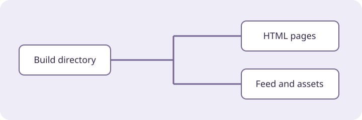
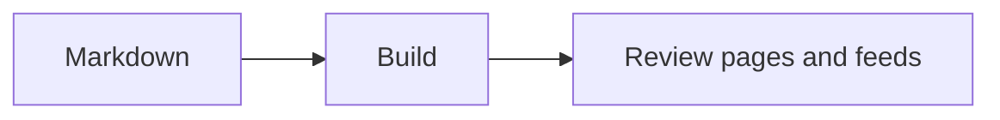

## Start with the artifact

Check a few representative files from a clean build before opening the preview. The goal is to make a missing file or broken reference visible as early as possible.



### Pick a small sample

| Sample  | What to check                                                  |
| ------- | -------------------------------------------------------------- |
| Home    | The title and navigation use the intended site configuration.  |
| Article | Its canonical URL and image point into the same deployment.    |
| Feed    | The item links resolve and the body includes a table or image. |

## Measure coverage

When a sample of size $n$ contains $p$ passing cases, use the ratio

$$
C = \frac{p}{n}
$$

as a compact progress check. It describes the sample, so keep the chosen cases with the result.

```ts
const sample = ["index.html", "rss.xml", "sitemap.xml"];
const output = new Set(["index.html", "rss.xml"]);
const missing = sample.filter((path) => !output.has(path));
console.log(missing);
```

## Record the checks



Record the base path and which output files were sampled so another reader can repeat the same checks.
